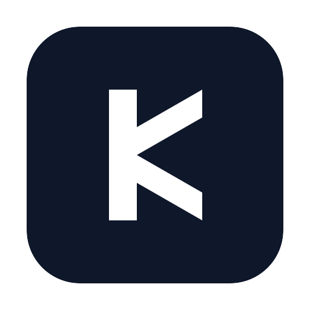

<p align="center">
  
</p>

<h1 align="center">KingMoat WAF</h1>

<p align="center">
  <b>Fortress for Every Request</b> · 固若金汤，御攻于无形
</p>

<p align="center">
  <a href="https://opensource.org/license/mulanpsl-2-0"></a>
  <!-- Release badge is maintained manually: bump the version here on each release (current latest published release: v1.0.0-stable) -->
  <a href="https://gitee.com/aiuc-labs/KingMoat-WAF/releases"></a>
  
  
</p>

<p align="center">
  <a href="README_EN.md"></a>
  <a href="README.md"></a>
</p>

KingMoat WAF is an open-source **All-in-one Web Application Firewall** written in pure Go: an in-house L7 reverse proxy carrying the traffic, Coraza (a ModSecurity SecLang-compatible engine) + OWASP CRS 4.x as the signature detection core. It runs as a single binary, stores its configuration in SQLite by default, and works out of the box.

> **⚠️ AI-generated disclosure**: the vast majority of this codebase was **written with AI assistance**, reviewed by humans and iterated with automated tests and security audits before release. We state this openly: it demonstrates what AI-assisted engineering can deliver for a small-scale security product — and it means this project needs community review more than a typical one. Found anything? Open an issue; we take every report seriously.

## 💡 Why KingMoat WAF

Mainstream open-source WAFs are not friendly to personal webmasters and small teams — either they limit the number of sites, or the deployment is heavy (facts as of 2026-09, sources linked):

| Project | License | Sites / services | Deployment |
|---|---|---|---|
| SafeLine (Leichi) Community | Community license (commercial use prohibited since 2025) | New installs capped at **10** protected sites (since 7.6.0; 50 since 2024-08); free-tier performance limits since 5.4.0 | Multi-container Docker Compose |
| BunkerWeb | AGPL-3.0 | Community edition unlimited, but advanced plugins (Anti-DDoS, advanced ACME, …) are paid PRO; one PRO license caps 100 services | scheduler + NGINX + UI multi-container |
| ModSecurity / Coraza + Nginx | Apache-2.0 (engine itself) | Unlimited | Engine-level component: you assemble, tune rules, and operate logs yourself — not a turnkey product |
| **KingMoat** | **MulanPSL-2.0** | **No site or concurrency limits** | **Single binary + SQLite, ready out of the box** |

Sources: [SafeLine docs](https://help.waf-ce.chaitin.cn/), [SafeLine GitHub](https://github.com/chaitin/SafeLine), [community-edition site limit analysis](https://blog.gitcode.com/0afe30162fd57701b513c6ed6fab6093.html), [BunkerWeb GitHub](https://github.com/bunkerity/bunkerweb), [BunkerWeb pricing](https://www.bunkerweb.io/pricing-plan/).

What small teams actually need is simple: **easy to install, easy to understand, easy to operate.** KingMoat WAF takes a different route: no site or concurrency quotas, authoritative upstream rules embedded, single-file deployment, and a graphical console. Individual webmasters and small-to-medium teams are welcome to use it, file issues, and suggest improvements.

## ✨ Key Features

**🚫 No quotas**

- No limits on sites or concurrency (no license metering; scales with your hardware); multi-site Host routing, weighted round-robin, active health checks + passive failover, SNI multi-certificate TLS, WebSocket pass-through

**🛡️ Authoritative upstream rules**

- Coraza v3 + OWASP CRS 4.x embedded in the binary (no external rule files, offline-friendly), full request-body buffering
- libinjection SQLi/XSS semantic layer as a second line of defense independent of CRS
- CRS thresholds, IP black/white lists, subscribed IP groups, and custom micro-engine rules are all configurable in the console; one-click false-positive whitelisting generates idempotent allow rules

**🤖 AI security assistant (read-only)**

- Embedded LLM security analyst: SSE streaming chat, one-click "ask AI" on attack logs, scheduled daily reports and spike-triggered reports, webhook/email delivery
- OpenAI-compatible templates (DeepSeek, Qwen, Zhipu, Kimi, Doubao, Ollama, …) + custom endpoints
- Outbound dynamic redaction ([ENT]/[USR]/[NET]/[INF]/[SEC] placeholders, restored on return, toggleable); hard-coded read-only tool table with zero write paths; optional MCP endpoint ([docs/AI.md](docs/AI.md))

**🔍 AI session audit**

- Automatically identifies LLM API calls proxied through the WAF (OpenAI / Anthropic / Gemini, plus domestic protocols such as Baidu Qianfan ERNIE, Alibaba DashScope/Bailian, MiniMax and SenseNova, and OpenAI-compatible endpoints like DeepSeek/Kimi/GLM), capturing request payloads and full model output into searchable, exportable session audit records
- Non-streaming tee + per-line SSE aggregation; multimodal images/audio replaced by placeholders; capture only on hit via an async queue that never blocks forwarding; sampling rate and request/response truncation caps are configurable
- Built-in redaction (sk-/Bearer/AKIA/password fields auto-masked, on by default); the "AI session audit" console page searches and views full transcripts; the settings tab applies on publish without a restart; optional central shipping to ClickHouse / Elasticsearch / Loki / S3 / syslog / Kafka ([docs/CONFIG.md](docs/CONFIG.md))

**🎯 Risk engine & asset discovery**

- R1–R7 observe-only risk engine: sensitive-data exposure / unauthorized-access clues / login brute force / shadow APIs / zombie APIs / admin-plane exposure / plaintext sensitive params; supports periodic full scans (configurable interval, hot-applied on publish) plus manual scans, with webhook notifications for new findings
- API asset discovery: post-response passive learning of the API inventory (path normalization + tagging + candidate denoising, separate SQLite DB, off by default); low-frequency shadow endpoints reach the risk view via the candidate pool instead of being hidden by the maturity gate
- Bot detection: UA tri-classification + client fingerprinting + rate signals, integrated with JS challenges

**🔒 Data-plane protection toolbox**

- CC rate limiting (fixed window, deny/throttle), slider CAPTCHA (SVG + HMAC pass cookie), lightweight JS challenge
- IP/CIDR black/white lists + subscribed IP group feeds, GeoIP country black/white lists (built-in DB-IP country database works out of the box; optional custom mmdb)
- Site-wide HTTP Basic auth (argon2id), HTTPS 308 redirect, real client IP resolution (trusted proxies)
- Response filtering: sensitive-data masking/blocking (phone/ID/secret presets + custom regex)
- Dynamic protection: per-request AES-GCM encryption of HTML responses with WebCrypto restoration (HTTPS required)
- Dual mode: `intercept` (block on hit) / `monitor` (log only, for new-site canary); friendly 502 upstream-error page
- Audit log: SQLite audit DB (`logs/audit.db`, daily snapshot archive) + in-memory ring for realtime queries, optional sanitized request snapshots; attack events carry the origin country (built-in GeoIP, shown in Chinese in the console)
- Local access-log recording (off by default): access logs of enabled sites land in a local SQLite DB (`access-logs.db`) and are searchable in the console without any shipping; daily retention + disk-ceiling eviction of the oldest data, sensitive query parameters masked before insert; residual data stays read-only searchable after recording is switched off (no automatic retention cleanup while recording is off; retention resumes once recording is re-enabled)

**⚙️ Control plane & operability**

- Versioned SQLite config store: append-only revisions, one-click rollback; atomic hot reload that keeps the old config on failed publishes
- Web console (Vue 3): dark tech-styled UI, graphical site protection config, attack/access log inline detail drawers, certificates, API security (assets + risks), AI session audit, AI assistant; RBAC (admin/operator/auditor) + MFA + API keys; build output embedded — deployment remains a single file
- Certificate management: site PEM + Let's Encrypt auto renewal (ACME, TLS-ALPN-01 + HTTP-01)
- Alerting & shipping: webhook events; log shipping to ClickHouse / Elasticsearch / Loki / S3 / Syslog / Kafka, with channel reuse and a one-click connectivity test
- Prometheus `/metrics` and a REST API reference (core endpoints in [docs/API.md](docs/API.md), full list served by the console at `/openapi.json`)

**Community edition scope**: this repository is the community edition focused on single-node All-in-one scenarios. Deployment forms: **all-in-one (recommended)** / static config file. If you need multi-node centralized management (node management), UI branding personalization, or other functional customization, contact the author.

## 🚀 Quick Start (all-in-one)

**Linux one-click deploy** (Debian 12+ / Ubuntu 24.04+ / openEuler 22.03+, auto-installs deps, downloads Release, registers systemd):

```bash
curl -fsSL https://gitee.com/aiuc-labs/KingMoat-WAF/raw/main/deploy/install.sh | bash
```

The installer picks ports interactively; defaults are data plane `80/443` and console `8443`. Occupied ports are re-prompted, or pass `-y --http-port/--https-port/--console-port` for non-interactive runs. 80/443 are privileged ports: the one-click deploy runs as root with `CAP_NET_BIND_SERVICE`, so they bind fine.

Or manual deployment (macOS / Windows / any platform):

```bash
# 1. Start a sample upstream (any)
python3 -m http.server 9000

# 2. Generate console admin credentials (optional but recommended)
export KMWAF_ADMIN_HASH=$(kmwafctl hash-password -password 'YourStrongPassw0rd!')

# 3. Start KingMoat WAF: data plane :80/:443 + console :8443, config stored in kingmoat.db (SQLite)
kingmoatwaf -config config.example.json -console-addr 127.0.0.1:8443

# 4. Verify blocking
curl -i -H "Host: localhost" "http://127.0.0.1/?id=1 UNION SELECT password FROM users"
# → 403 blocked (X-Kingmoat-Rule: coraza/rule-949110), event written to the SQLite audit DB logs/audit.db

# 5. Open the console to publish/modify config (hot reload, no restart)
#    https://127.0.0.1:8443/
```

> Built-in admin account: `kmadmin`. **The initial password is not in this document and not baked into the binary**: set `KMWAF_BOOTSTRAP_PASSWORD`, or read the random one written to `initial-admin-password.txt` in the console data directory on first boot (0600, delete it after reading, e.g. `sudo cat /var/lib/kingmoatwaf/initial-admin-password.txt`). A password change is forced at first login; if you bind the console to a non-loopback address, preset a strong password via `KMWAF_ADMIN_HASH` (step 2) to skip that window.

For Docker / systemd / Windows service deployment see [deploy/README.md](deploy/README.md) (deployment overview, prerequisites and the go-live checklist; the same directory ships the distroless Dockerfile, docker-compose, kingmoatwaf.service and windows.md).

## 🧰 Build from Source

Requirements: Go 1.26+, Node.js 18+ (for the console frontend).

```bash
# One-shot build for all three platforms (frontend build, dist backfill, license list included)
./scripts/build.sh <version>            # Linux / macOS
.\scripts\build.ps1 -Version <version>  # Windows (windows/amd64, linux/amd64, linux/arm64)

# Or step by step
(cd web/console && npm install && npm run build)   # build the console frontend
# copy web/console/dist output into internal/webui/dist (go:embed directory)
go build ./...
```

## Development

```bash
go build ./...   # build
go vet ./...     # static checks
go test ./...    # unit + integration tests (CRS regression / config center / API / hot reload)
```

> Release artifacts (`scripts/build.ps1` / `scripts/build.sh` / `deploy/Dockerfile`) build with `-tags no_fs_access` (skips coraza's /tmp writability probe for hardened systemd sandboxes); carry the same tag when building a deployable binary yourself.

CI: `.github/workflows/ci.yml` (build / vet / test). Architecture design and dependency license compliance: [docs/ARCHITECTURE.md](docs/ARCHITECTURE.md); config reference: [docs/CONFIG.md](docs/CONFIG.md); release history: [CHANGELOG.md](CHANGELOG.md).

## 📚 SDK Mode

```go
package main

import (
    "net/http"

    "github.com/kingmoat/kingmoat/pkg/kingmoat"
)

func main() {
    eng := kingmoat.New(kingmoat.Options{
        Mode: kingmoat.ModeMonitor, // observe first, then intercept
    })
    http.ListenAndServe(":8080", eng.Handler(yourHandler))
}
```

## Contributing

Issues and pull requests are welcome. Once more: this codebase is predominantly AI-generated, so review — on security, correctness, and engineering taste alike — is especially valued. Please do not open public issues for security vulnerabilities — contact the maintainers privately first. Commits must be signed off (DCO, `git commit -s`).

For **multi-node centralized management (node management), UI branding personalization, other functional customization**, or **paid technical support**, contact the author: [labs@aiuc.cc](mailto:labs@aiuc.cc).

## License

[Mulan Permissive Software License, Version 2 (Mulan PSL v2)](https://opensource.org/license/mulanpsl-2-0) — bilingual, with an express patent grant, combination-compatible with Apache-2.0; see [LICENSE](LICENSE) and [NOTICE](NOTICE); the Chinese text prevails. Third-party dependencies and rule sets (Coraza, OWASP CRS, libinjection, etc.) keep their own licenses (Apache-2.0/MIT/BSD, etc.) — see [THIRD-PARTY-LICENSES](THIRD-PARTY-LICENSES).
